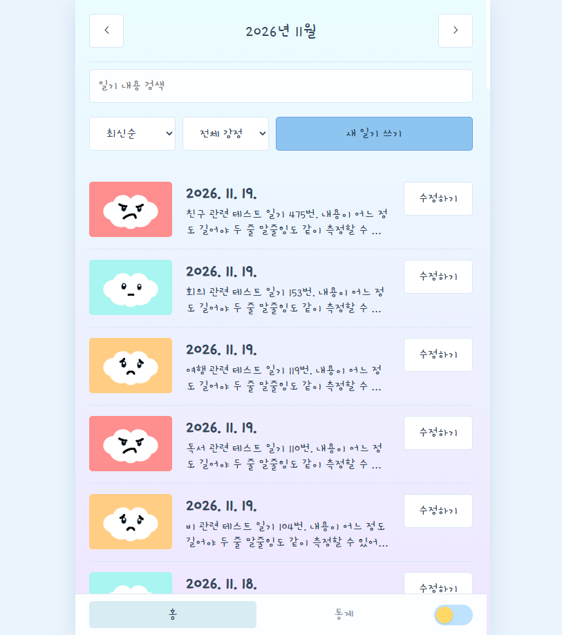
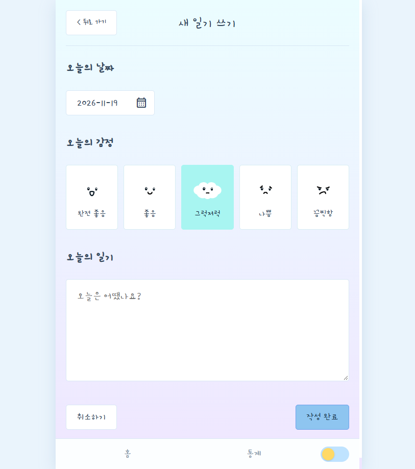
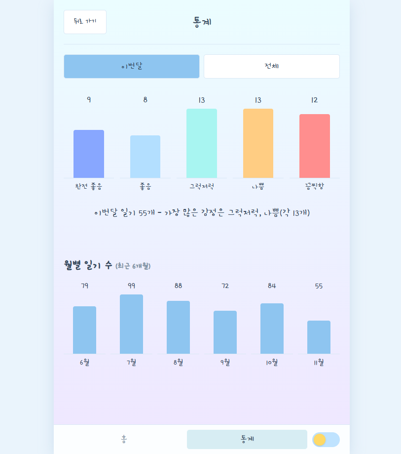
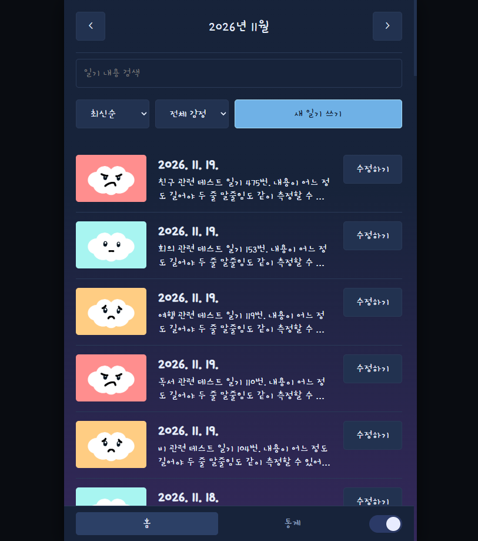

# 감정 일기장 (MyDiary)

하루의 감정을 고르고 일기를 남기면, 감정과 월별 기록을 통계로 돌아볼 수 있는 웹 앱입니다.
퍼블리싱(HTML/CSS/jQuery) 경험을 바탕으로 React와 TypeScript를 배우며 만들었습니다.

- **데모**: https://my-diary-roan.vercel.app
- **저장 방식**: 서버 없이 브라우저 `localStorage`에 저장합니다. 데이터는 내 브라우저에만 남습니다.

| 홈 | 일기 작성 | 통계 | 다크 모드 |
|:---:|:---:|:---:|:---:|
|  |  |  |  |

## 주요 기능

- 일기 **작성 / 조회 / 수정 / 삭제**, 날짜와 감정(5종) 선택
- **월별 보기**: 이전/다음 달로 이동하며 해당 월의 일기 확인
- **검색**: 검색어를 입력하면 월에 상관없이 **전체 기간**에서 찾음
- **정렬**(최신순/오래된순)과 **감정별 필터**
- **통계**: 감정별 개수, 최근 6개월 작성량을 막대 차트로 표시 (이번 달/전체 기간 전환)
- **다크 모드**: 기기 설정을 따르고, 직접 바꾼 선택은 기억
- **모바일 대응**과 **키보드/스크린리더 접근성** 고려

## 기술 스택

| 구분 | 사용 기술 |
|---|---|
| 프레임워크 | React 19 |
| 언어 | TypeScript |
| 빌드 도구 | Vite |
| 라우팅 | React Router |
| 스타일 | CSS (CSS 변수로 테마 관리, 별도 UI 라이브러리 없음) |
| 상태 관리 | `Context` + `useReducer` |
| 차트 | 라이브러리 없이 직접 구현 |

## 실행 방법

```bash
npm install
npm run dev      # 개발 서버 (표시되는 주소로 접속)
npm run build    # 배포용 빌드
```

Node.js(LTS 버전)가 설치되어 있어야 합니다.

## 폴더 구조

```
src/
├── component/    # 재사용 컴포넌트 (DiaryList, DiaryItem, Editor, 차트 등)
├── context/      # DiaryContext, ThemeContext, ThemeProvider
├── hooks/        # 커스텀 훅 (useDiary: 주소의 id로 일기 한 개 찾기)
├── img/          # 감정 이미지
├── pages/        # Home, New, Edit, Diary, Stats (화면 단위)
├── App.tsx       # 라우팅과 일기 상태 관리
├── main.tsx      # 앱 진입점 (BrowserRouter로 감싸 렌더링)
├── types.ts      # 일기 데이터 타입
└── util.ts       # 날짜 포맷, 통계 계산 등 공통 함수
```

## 구현하면서 고민한 점

### 1. 상태 구조: 읽기와 쓰기를 나눈 Context + `useReducer`
일기 데이터는 `useReducer`로 관리하고(`CREATE` / `UPDATE` / `DELETE`), 데이터를 읽는 Context(`DiaryStateContext`)와 변경 함수를 주는 Context(`DiaryDispatchContext`)를 분리했습니다. 컴포넌트가 "읽기만 하는지, 바꾸기만 하는지"가 코드에서 드러나도록 하기 위해서입니다. 초기값은 `localStorage`에서 한 번만 읽도록 지연 초기화(`useReducer`의 세 번째 인자)를 사용했습니다.

### 2. 파생 값은 계산하고, `useEffect`는 바깥 세계와 맞출 때만
검색, 필터, 정렬 결과와 통계 수치는 state로 따로 저장하지 않고 `useMemo`로 계산했습니다. `useEffect`는 테마를 `<html data-theme>`에 반영하는 것처럼 **React 바깥(DOM)과 동기화**할 때만 쓰고, `localStorage` 저장 같은 사용자 행동의 결과는 이벤트 핸들러에서 처리했습니다.

### 3. 검색은 전체 기간, 평소에는 현재 월
검색어가 있으면 월 필터를 풀고 전체 기간에서 찾도록 해서 "지난달에 쓴 일기를 못 찾는" 상황을 없앴습니다. 결과가 없을 때의 안내 문구도 상황(검색 결과가 없음 / 해당 월에 작성된 일기 없음 / 조건에 맞는 일기 없음)에 맞게 나눴습니다.

### 4. 차트를 라이브러리 없이 구현
막대 높이를 `(개수 / 최댓값) × 100%`로 계산하는 방식으로 감정별 차트와 최근 6개월 차트를 직접 만들었습니다. 모든 값이 0일 때 0으로 나누지 않도록 최댓값에 최소 1을 두었고, 기록이 없는 달도 0으로 채워 막대 위치가 밀리지 않게 했습니다. 처음 열 때 막대가 아래에서 올라오는 효과는 `@keyframes`로 처리했습니다.

### 5. 다크 모드: CSS 변수와 첫 화면 깜빡임 방지
색상을 모두 CSS 변수로 두고 `:root[data-theme="dark"]`에서 값만 교체했습니다. 새로고침 때 라이트 화면이 잠깐 보이는 문제는 React 실행 전에 `index.html`의 인라인 스크립트가 먼저 테마를 지정하도록 해 해결했습니다.

### 6. 접근성
감정 선택은 `div` 클릭이 아니라 **네이티브 라디오 버튼**(숨김 처리 + 포커스 표시)으로 만들어 키보드 방향키로도 선택됩니다. 버튼/링크/`nav` 같은 기본 태그를 먼저 쓰고, 필요한 곳에만 `aria-label`, `aria-pressed`, `role="alert"` 등을 사용했습니다.

### 7. 렌더링 성능: 측정하고, 고쳐야 할 곳만 고치기
추측으로 최적화하지 않으려고 React Profiler로 측정했습니다. (임시로 일기를 500개 생성 후 개발 모드에서 측정)

- **검색어 입력 시 약 220ms**: 원인은 "다시 그리기"가 아니라, 월 목록에서 전체 기간 검색 결과로 바뀌면서 **수백 개의 항목이 새로 만들어지는 비용**이었습니다. `memo`로 줄일 수 없어 현재 규모에서는 최적화 대상에서 제외했습니다.
- **다크 모드 토글 시 약 59ms**: 일기 내용이 바뀌지 않는데도 목록 전체가 다시 그려졌습니다. `DiaryItem`에 `memo`를 이미 적용했는데도 "Context changed"가 원인이었는데, 테마 상태가 `App`에 있어 `Routes`까지 다시 그려지고 `Link`/`useNavigate`가 읽는 라우터 Context가 바뀌었기 때문입니다.
- **개선**: 테마 상태를 `ThemeProvider` 컴포넌트로 분리해 토글 시 `ThemeProvider`만 다시 그려지게 했고, 일기 55개 기준 **약 59ms → 0.4ms**로 줄었습니다. (개발 모드 기준, 3회 측정 평균)

### 8. 모바일 대응
기본은 비율로 늘고 줄어드는 레이아웃(`flex: 1`, `max-width`)으로 잡고, 글자 크기처럼 세부 조정만 미디어쿼리(`@media`)를 각 컴포넌트 CSS에 두었습니다.

## 한계와 개선 아이디어

- 일기가 수백 개 이상이면 검색 결과를 한 번에 그리는 비용이 커집니다(측정 결과 참고). 페이지 나누기나 가상 스크롤이 필요합니다.
- 데이터가 브라우저 `localStorage`에만 있어서 브라우저 데이터를 지우면 사라집니다.